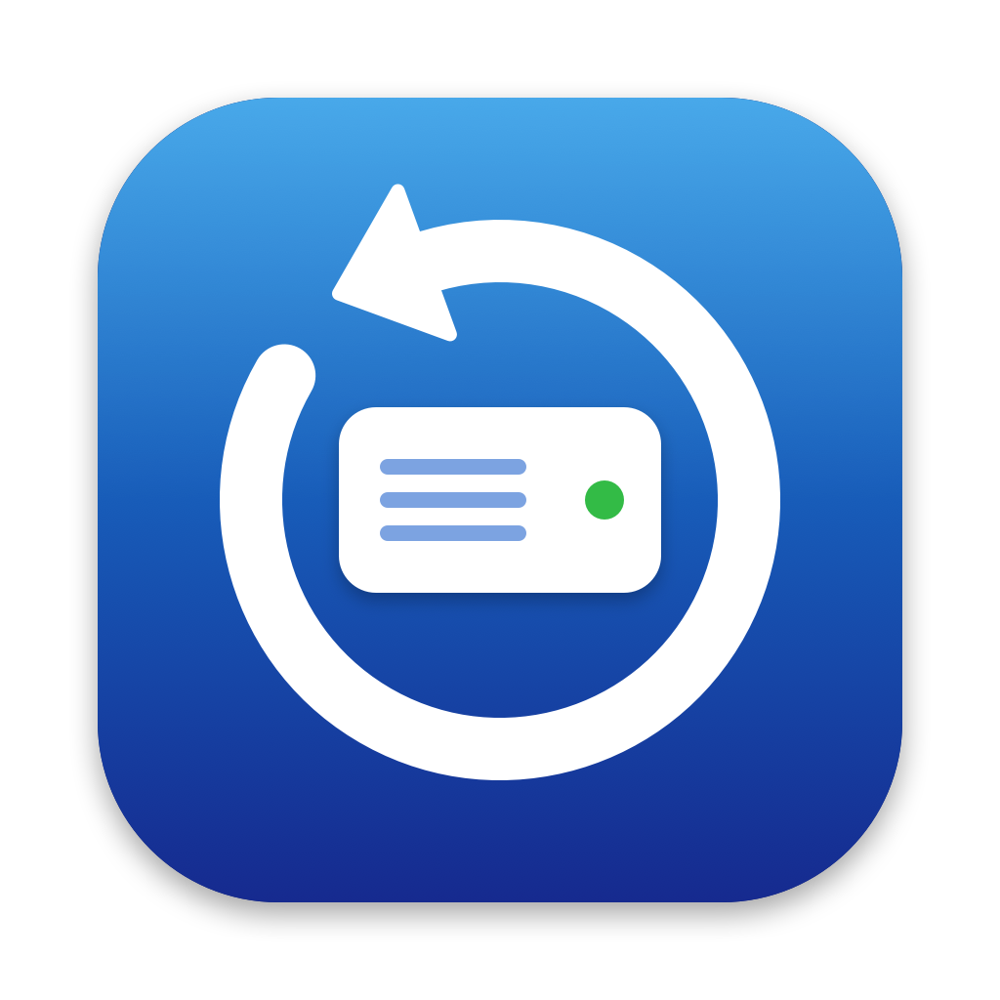

<p align="center"></p>

# Revive

Created by **Kunal** · [lutly.video@gmail.com](mailto:lutly.video@gmail.com)

**Data recovery for Mac.** Get files back from damaged, unmountable or formatted drives:
SSDs, USB drives and memory cards. Built for video editors: it recovers After Effects and
Premiere Pro projects together with their media.

## Features

- **Recover Files (APFS).** Rebuilds the folder tree of an APFS drive that macOS can no longer
  mount, from index pieces still on the drive. Files come back with their **real names and
  folders**. Browse the tree, search by name, tick folders or single files, or select all
  projects, videos, photos, audio or documents in one click.
- **Lost folders and unnamed files.** Folders whose own record was destroyed still appear
  ("Lost folder #…"), and data whose name was lost appears under "Unnamed files".
- **Deep Scan.** Finds photos, videos, audio, PDFs, Office files and Adobe projects by their
  content. Works on any drive, including formatted ones. Files get numbered names. It can also
  rejoin videos whose index was stored apart from their data ("Repair Broken Videos").
- **Repair Drive.** Checks an APFS drive and, if its main superblock is damaged, restores it from
  the newest valid copy, keeping a backup so the change can be undone.
- **Safe by design.** Recover Files and Deep Scan only read the damaged drive. Scans are saved,
  and recoveries can be stopped and continued later without copying anything twice.

## Requirements

- macOS 14 Sonoma or later, Apple silicon or Intel.
- **Full Disk Access** for Revive (System Settings › Privacy & Security › Full Disk Access).
  macOS does not let any app read a raw drive without it. Revive shows a banner with a
  button that opens the right settings page.
- An administrator password, which macOS asks for when reading a physical drive.

## How to use

1. Connect the damaged drive. Stop using it for anything else.
2. **Recover Files** › choose the drive › **Scan Drive**. A 1 TB drive takes about 30–40 minutes
   on a fast USB-C cable. You can finish early once the "found" numbers stop growing.
3. Tick what you want, choose a destination on a **different** drive, and click
   **Recover Selected**. Every recovery folder contains a `REPORT.txt`.
4. If nothing useful is found, try **Deep Scan**.

Tip: use the drive's original USB-C cable. Many cables only run at USB 2 speed (about 40 MB/s
instead of 400+ MB/s).

## Limits

No recovery tool can bring back data the drive has already erased (TRIM after deletion),
encrypted volumes without their password, or parts of files that were overwritten. Such files
are marked INCOMPLETE in the report.

## Building

```sh
./build.sh                                    # ad-hoc signed, for your own Mac
SIGN_ID="Developer ID Application: …" ./build.sh  # for distribution
```

The build produces `build/Revive.app` and `build/Revive-1.0.zip`. To share it with other people
without Gatekeeper warnings, sign it with an Apple Developer ID and notarize it
(`xcrun notarytool submit build/Revive-1.0.zip --wait`, then `xcrun stapler staple build/Revive.app`).
Unsigned builds open with right-click › Open.

The app icon is drawn by `Icon/make-icon.swift`.

## Command line

The app binary doubles as the recovery engine:

```
Revive --apfs-folders <device> <outDir> <progress.json> <uid> <gid> <projects 0|1> [selectors…]
Revive --carve <device> <outDir> <progress.json> <kinds> <uid> <gid> [startOffset]
Revive --apfs check|repair|undo <device> <backupFile>
Revive --fix-videos <scanFolder>
Revive --apfs-catalog <INDEX.nodes> <out.tsv>
```

Selectors for `--apfs-folders`: a folder name, `#<folderId>`, `+<file with file ids>`,
`%<streamId>` (unnamed data), `@<INDEX.nodes>` (reuse a saved scan), `!scanonly`.

## Download

Get the latest `Revive-x.y.zip` from the [Releases](https://github.com/kunalsharmavlog-hue/revive/releases) page,
unzip it, move **Revive.app** to Applications, then right-click › **Open** the first time
(the build is not notarized yet).

## Author and license

Revive was created by **Kunal**. Contact: [lutly.video@gmail.com](mailto:lutly.video@gmail.com).

Released under the [MIT License](LICENSE). You may use, change and share it, as long as the
copyright notice stays included. Revive comes without any warranty: data recovery is never
guaranteed, so always keep backups.
